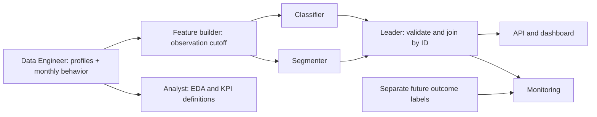

# Integration contract v1.0

`contracts.py` is the executable source of truth. Unknown columns, missing values, invalid ranges and duplicate keys are rejected. Use `validate_table` at handoff boundaries. Table columns may arrive in any order; model feature order is fixed by `FEATURE_COLUMNS`. CSV readers preserve string IDs, including leading zeroes.

## Data flow

| Boundary | Schema / required columns | Key |
| --- | --- | --- |
| Customer profiles | `Customer`: customer_id, age, balance, country | customer_id |
| Monthly behavior | `MonthlyBehavior`: customer_id, month, transaction_count, transaction_amount, login_count, complaint_count, mobile_count, atm_count, branch_count | customer_id + month |
| Model features | `FeatureRow`: customer_id, age, balance, transaction_count, transaction_amount, login_count, complaint_count, mobile_share | customer_id |
| Training/evaluation labels | `LabelRow`: customer_id, churn | customer_id |
| Classification output | `RiskRow`: customer_id, risk_score | customer_id |
| Segmentation output | `SegmentRow`: customer_id, segment_id | customer_id |
| Segment profiles | `SegmentProfile`: segment_id, segment_name, description, customer_count | segment_id |
| Integrated output | customer_id, risk_score, segment_id | customer_id |

Each prediction branch must return exactly the input customer set once; ordering is irrelevant. Unknown segment IDs fail integration. `customer_count` describes the segment's profiling dataset, not necessarily an API request batch. Demographic strings such as country remain in the customer table; this minimal feature v1 does not encode country. Propose extensions through a coordinated contract change.

## Python seams

| Module / owner | Entry point | Return value |
| --- | --- | --- |
| data / Data Engineer | `generate_demo(seed, n_customers)` | `(customers_df, monthly_behavior_df)` |
| data / Data Engineer | `validate_inputs(customers, behavior)` | quality summary dict; raises on invalid inputs |
| features / Classification + Data Engineer | `build_features(customers, behavior, as_of_date, observation_months)` | FeatureRow dataframe |
| analysis / Analyst | `summarize(features, customers, behavior)` | JSON-safe descriptive summary |
| classification / Classification owner | `build_bundle(features)`; `load_model(bundle)` | manifest dict; object satisfying Classifier protocol |
| classification / Classification owner | `predict_risk(features)` | RiskRow dataframe |
| segmentation / Segmentation owner | `build_bundle(features)`; `load_model(bundle)` | manifest dict; object satisfying Segmenter protocol |
| segmentation / Segmentation owner | `assign_segments(features)` | SegmentRow dataframe |
| segmentation / Segmentation owner | `describe_segments(assignments)` | SegmentProfile dataframe |
| integration / Leader | `predict(features, classifier, segmenter, profiles)` | integrated dataframe |

Demo bundle builders only verify schemas. Real training must add a separate training entry point accepting labels/split specification, then supply the same inference protocol. It must be reviewed with the leader; inference never receives labels. Preprocessing fit on training data must travel with the real model bundle. The existing loader explicitly rejects non-demo bundles, so changing to real models requires an intentional loader review rather than silent promotion.

## Observation window and missingness

Default: as-of 2026-04-01, previous three completed months = January–March 2026. For any April as-of date, April monthly rows are excluded, because full-month totals could include future activity. Out-of-window rows do not contribute to features. Customers without in-window rows receive zero activity; raw source nulls must be handled and documented by Data Engineer before validation.

Zero activity is a fixture convention. Missing coverage may mean unavailable data in reality; revise this assumption with an explicit coverage feature before using real incomplete histories. v1 has one snapshot per customer, not multiple customer-date observations.

## HTTP interface

- `GET /health`: ready status, `mode`, contract version, classifier/segmenter versions.
- `POST /predict`: exact envelope `{contract_version: "1.0", customers: [FeatureRow, ...]}`; 1–1000 rows, unique IDs. Response contains `mode`, `contract_version`, `model_versions`, and `predictions`.
- Invalid input: HTTP 422. Broken model output: HTTP 500. Missing/incompatible artifacts: startup fails. Model versions and mode are always visible.
- API accepts prepared features. Raw profile/history loading and customer lookup are dashboard responsibilities in this v1.

See `examples/predict_request.json` and `examples/predict_response.json` for full examples, and `/docs` for generated OpenAPI documentation.

## Contract changes

Propose the schema change in a PR, identify every producer/consumer, update validators, examples, docs, tests and artifact version together. Breaking schema/meaning changes increment the major contract version. Never just rename an output column in one module. Contract constants, request version and config version must agree.
