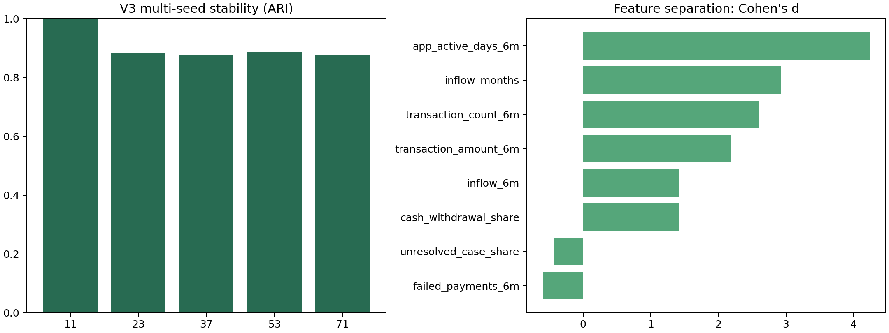
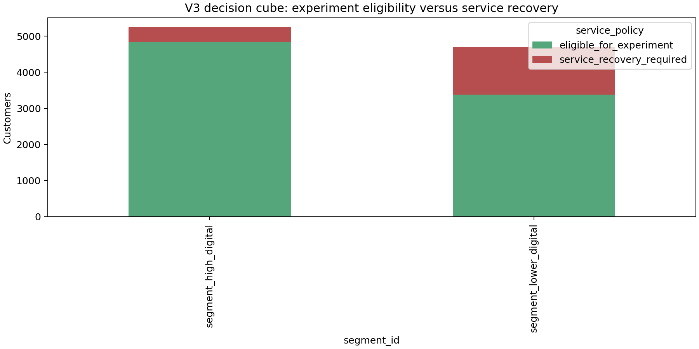

# Playbook CEO V3: giữ khách bằng dịch vụ đúng lúc, không bằng khuyến mãi đại trà

## 1. Quyết định cần phê duyệt

Trong danh mục 10.000 khách, có hai tình huống cần quản lý khác nhau.

- **Nhóm dùng số thấp, quan hệ có dấu hiệu yếu:** 4.757 khách, chiếm 47,6% danh mục. Nhãn churn lịch sử là 27,0% (1.285 khách), cao hơn mức chung 20,4%. Đây là ưu tiên số một.
- **Nhóm dùng số thường xuyên:** 5.243 khách, chiếm 52,4%. Nhãn churn lịch sử là 14,3% (752 khách). Đây không phải nhóm “an toàn”; đây là nhóm cần giữ trải nghiệm tốt vì quy mô lớn.

CEO cần phê duyệt hai pilot có mục tiêu khác nhau: một pilot nhằm khôi phục quan hệ yếu, một pilot nhằm giữ trải nghiệm số trơn tru. Không có pilot nào được phép tự động tặng tiền, liên hệ khách chưa consent, hoặc liên hệ khách đang có case dịch vụ chưa xử lý.

## 2. Vì sao tin vào hai phân khúc này ở mức đủ để thử nghiệm

Ba phương pháp được so sánh trên cùng tập hành vi mô phỏng sáu tháng. K-Means được chọn vì dễ phục vụ CRM và ổn định nhất khi chạy lại: stability 0,979; Gaussian Mixture đạt 0,635; Ward đạt 0,585. K-Means không được chọn vì “phức tạp”, mà vì hai nhóm gần bằng nhau và membership thay đổi ít qua kiểm tra kỹ thuật.

Các feature tách nhóm mạnh nhất là app-active days (Cohen's d 4,28), số tháng có dòng tiền vào (2,91), số giao dịch (2,57), tổng giá trị giao dịch (2,19) và tiền vào sáu tháng (1,39). Đây là bằng chứng hai nhóm khác nhau trong simulation. Nó không chứng minh vì sao khách rời bỏ.

## 3. Nhóm 1: dùng số thấp, cần phục hồi quan hệ

### Chân dung vận hành

Nhóm này chỉ có 24,5 ngày dùng app trong sáu tháng, khoảng 4 ngày mỗi tháng. Họ có 1,4 tháng có dòng tiền vào, 26,4 giao dịch trong sáu tháng và tỷ lệ tiền rút tiền mặt cao hơn nhóm kia. Họ có 0,64 failed payment trong sáu tháng và 30,6% service case chưa được giải quyết trong simulation.

Trong dữ liệu Kaggle tĩnh, tuổi trung bình 40,1; 45,8% nữ và 54,2% nam. France chiếm 49,9%, Germany 25,5%, Spain 24,6%. Chỉ 12,9% có cờ active-member. Salary estimate median là 92.983 và balance median là 99.341, nhưng dataset không nêu currency. Country không phải quê quán; salary/balance không phải value hay lợi nhuận.

### Điều có thể đang xảy ra

Đây là giả thuyết vận hành, không phải kết luận về động cơ: nhịp dùng dịch vụ thấp, dòng tiền không đều, failed payment và unresolved service case cao hơn. Hai hướng xử lý có ý nghĩa khác nhau: giải quyết một trải nghiệm hỏng, hoặc giúp khách quay lại dùng một hành vi đơn giản. Pilot phải cho biết hướng nào tốt hơn.

### Pilot P1: Service recovery so với Reactivation coach

| Arm | Khách nhận gì | Bộ phận chịu trách nhiệm | Việc phải log |
| --- | --- | --- | --- |
| A. Service recovery | Review case, liên hệ trong SLA, nêu rõ owner và thời hạn, xác nhận closure; không upsell trước closure | Customer Care + Operations | case ID, category, opened/resolved time, re-open, satisfaction prompt |
| B. Reactivation coach | Journey 14 ngày, một tác vụ rõ ràng, hướng dẫn trong app, tối đa một reminder; không cash incentive | CRM Lifecycle + Digital Product | delivery, view, completion, app activity, opt-out |

**Eligibility:** chỉ khách consented, dưới contact cap, không có unresolved case. Khách có unresolved case bắt buộc vào service recovery ngoài experiment; không được randomize bỏ qua dịch vụ.

**Mục tiêu SMART:** trong 90 ngày, xác định arm nào tạo incremental active-month rate tốt hơn arm kia với cận dưới CI 95% lớn hơn 0, đồng thời không vượt guardrail. MDE 3 điểm phần trăm hiện cần 4.360 khách mỗi arm, lớn hơn cohort eligible hiện có. Vì thế CRM phải chọn MDE lớn hơn, kéo dài quan sát hoặc mở rộng cohort trước launch.

**Leading KPI hằng tuần:** tỷ lệ contact thành công, case closure within SLA, re-open rate, completed journey, app-active days, failed-payment count. **Guardrail:** consent breach = dừng ngay; complaint, opt-out, repeat contact và contact frequency vượt ngưỡng đã ký = pause và review trong 24 giờ.

## 4. Nhóm 2: dùng số thường xuyên, cần bảo vệ trải nghiệm

### Chân dung vận hành

Nhóm có 67,2 ngày dùng app trong sáu tháng, gần 11 ngày mỗi tháng; 4,9 tháng có dòng tiền vào, 41,8 giao dịch và 1.416 giá trị giao dịch. Failed payment là 0,24/sáu tháng; unresolved case share là 10,5% trong simulation.

Trong dữ liệu tĩnh, tuổi trung bình 37,8; 45,0% nữ, 55,0% nam; 89,8% có active-member flag. Median salary estimate 106.656, median balance 94.631; các số này không đại diện cho contribution hay CLV.

### Điều có thể đang xảy ra

Nhóm này sử dụng đều hơn và có churn lịch sử thấp hơn. Mục tiêu không phải ép bán thêm. Mục tiêu là tránh làm hỏng trải nghiệm của một nhóm lớn và nhận biết treatment nào giúp khách tự phục vụ tốt hơn.

### Pilot P2: Digital concierge so với Value review

| Arm | Khách nhận gì | Bộ phận chịu trách nhiệm | Việc phải log |
| --- | --- | --- | --- |
| A. Digital concierge | Guidance theo ngữ cảnh trong app, đường tắt đến self-service hoặc hỗ trợ | Product + CRM | exposure, task completion, support contact trong 7 ngày |
| B. Value review | Lời mời xem fee/benefit hiện hữu và chọn có muốn tư vấn tiếp hay không | CRM + Product | acceptance, completion, product-fit response, opt-out |

**Mục tiêu SMART:** trong 90 ngày, arm thắng phải có retention cao hơn arm còn lại với cận dưới CI 95% lớn hơn 0, không làm complaint/opt-out xấu hơn và có cost/saved customer dưới mức Finance duyệt. Với MDE 2 điểm phần trăm, cần 4.920 khách mỗi arm. Pilot hiện chưa đủ mẫu; không launch cho đến khi power được cập nhật.

## 5. Decision cube và công suất

Decision cube tách behavioral segment × active status × service policy × simulated cashflow scenario. Ví dụ, 1.678 khách dùng số thấp, not-active, đủ điều kiện thử nghiệm và lower-cashflow scenario; 984 khách cùng nhóm cần service recovery trước. Cashflow scenario chỉ dùng để lập công suất trong simulation, không dùng quyết định offer.

## 6. RACI và nhịp điều hành

| Owner | 0–30 ngày | Khi pilot chạy | Quyết định bắt buộc |
| --- | --- | --- | --- |
| CRM Director | consent, contact cap, randomization list | arm balance, delivery, opt-out | pause/scale request |
| Care Director | case taxonomy, SLA, escalation | closure/reopen, backlog | service-first routing |
| Product Director | task design, analytics events | completion/drop-off, defect backlog | fix/rollback experience |
| CFO delegate | contribution and cost assumptions | cost/contact, cost/saved | break-even approval |
| Risk/Compliance | suppression and fairness plan | consent breach, aggregate exposure | immediate stop authority |
| Analytics Lead | protocol/power lock | CI, data QA, experiment readout | declare winner/no-result |

CEO receives one page weekly: eligible/contacted by arm, consent failures, SLA, opt-out/complaint, leading KPI, spend and data-quality alert. At day 90, CEO receives effect estimate with CI, cost/saved customer, fairness exposure and one choice: stop, iterate or scale.

## 7. Risks that must remain visible

1. All behavioural and service facts are synthetic; they support a rehearsal, not a production claim.
2. Churn is historical/static; it is not next-quarter risk.
3. The power calculation already blocks a small-MDE launch. This is a valid no-go signal, not a reporting failure.
4. No Finance-approved contribution, cost or uplift exists. ROI cannot be stated.
5. Gender/country are aggregate fairness fields only. They never determine channel, treatment, price or eligibility.

## 8. Evidence links

[Multi-seed diagnostics](../reports/segmentation/v3/multi_seed_diagnostics.csv) · [Effect sizes](../reports/segmentation/v3/distinctiveness.csv) · [Segment churn](../reports/segmentation/v3/segment_churn.csv) · [Decision cube](../reports/segmentation/v3/decision_cube_v3.csv) · [Pilot protocol](../reports/segmentation/v3/pilot_protocol_v3.csv) · [Manifest](../reports/segmentation/v3/manifest.json)
