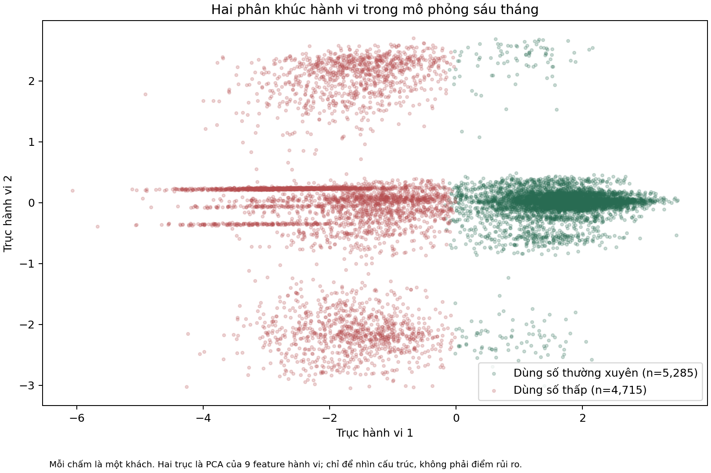

# Persona cards V3: hai kiểu quan hệ khách hàng cần hai cách quản lý

Biểu đồ là bản đồ hành vi sáu tháng mô phỏng. Mỗi chấm là một khách; vị trí được rút từ chín chỉ số về giao dịch, dòng tiền, app usage, failed payment và service case. Nó không phải “điểm rủi ro”. Nó cho CEO thấy hai kiểu sử dụng tách thành hai vùng đủ rõ để vận hành bằng hai playbook khác nhau.

## Persona 1: khách duy trì quan hệ số

**Quy mô:** 5.263 khách, 52,6% danh mục. Đây là cụm lớn hơn. Họ không cần được coi là “khách tốt cần bán thêm”; họ là nhóm ngân hàng cần tránh làm phiền và giữ trải nghiệm ổn định.

**Họ trông như thế nào:** tuổi trung bình 39,6; 44,2% nữ. Có 97,3% mang cờ active-member và bình quân 1,54 sản phẩm. Salary estimate median 100.408, balance median 96.462, đơn vị tiền tệ không xác định. Những số này không đo thu nhập thực, CLV hay khả năng chi trả.

**Họ làm gì trong simulation:** họ dùng app thường xuyên, dòng tiền vào xuất hiện đều hơn, giao dịch nhiều hơn, failed payment ít hơn và service case chưa đóng ít hơn. Đây là chân dung “khách tự phục vụ đều”, không phải bằng chứng họ hài lòng.

**Điều ngân hàng cần làm:** giữ luồng số đơn giản. Khi họ gặp khó khăn, ưu tiên đường tắt self-service và trạng thái xử lý rõ ràng trước khi mời review sản phẩm. Không có lý do để discount hàng loạt.

**Hai phương án cần so sánh:** Digital concierge, hướng dẫn đúng lúc trong app; hoặc Value review, giải thích fee/benefit hiện hữu rồi để khách tự chọn có muốn tư vấn. Success sau 90 ngày là arm thắng có retention cao hơn với lower CI 95% lớn hơn 0, không làm complaint/opt-out xấu hơn.

## Persona 2: khách có quan hệ số thưa, cần ưu tiên bảo vệ

**Quy mô:** 4.737 khách, 47,4% danh mục. Cụm này gần bằng nửa portfolio, không phải micro-segment có thể bỏ qua.

**Họ trông như thế nào:** tuổi trung bình 38,1; 46,8% nữ. Chỉ 0,6% mang cờ active-member; bình quân 1,52 sản phẩm. Salary estimate median 100.101 và balance median 98.218. Sự tương đồng về salary/balance nhưng khác rất mạnh về active-member cho thấy không nên dùng số dư để đo sức khỏe quan hệ.

**Họ làm gì trong simulation:** app activity, số tháng có dòng tiền vào và số giao dịch thấp hơn rõ rệt; failed payment và unresolved case cao hơn. Đây là tín hiệu vận hành cho thấy quan hệ đang yếu trong kịch bản mô phỏng. Nó chưa nói khách rời đi vì phí, vì đối thủ hay vì sản phẩm.

**Điều ngân hàng cần làm:** phân luồng service trước marketing. Khách có case chưa giải quyết đi vào Service recovery bắt buộc. Khách không có case mở mới được thử Reactivation coach với một hành vi cụ thể trong 14 ngày.

**Hai phương án cần so sánh:** Service recovery, xử lý case theo SLA và xác nhận closure; hoặc Reactivation coach, hướng dẫn một tác vụ trong app, không cash incentive. Dừng ngay khi vi phạm consent hoặc route nhầm khách có case mở. Không scale nếu effect 90 ngày không có lower CI 95% lớn hơn 0 hoặc chưa đạt break-even.

## Điều CEO cần nhớ

Hai persona được xác định bằng hành vi mô phỏng; giới tính, country, salary estimate và balance chỉ dùng để mô tả/fairness, không dùng chọn offer. Lý do churn thật, nhu cầu thật và hiệu quả từng treatment vẫn phải được đo qua case taxonomy, consent log và pilot ngẫu nhiên.
