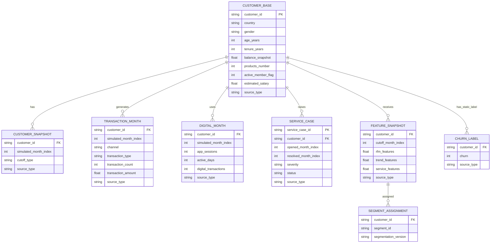

# V2 data architecture and ERD

## Design basis

The design separates an account/customer profile from dated behavioural facts. This follows the common account-to-transaction pattern illustrated by the [FDX open-finance overview](https://fdx1dev.financialdataexchange.org/wp-content/uploads/2026/02/ABCs_of_APIs_FINAL_1.pdf), and keeps merchant/channel fields separate from the customer. Merchant/category examples are informed by Visa's documented transaction-enrichment fields, including merchant category, merchant location and payment-acceptance method ([Visa Merchant Search](https://developer.visa.com/api-reference/merchant_search)). These references guide the schema only; they do not supply project data or validate the synthetic values.

## Grains and non-negotiable joins

| Table | Grain | Join / integrity rule | Source class |
| --- | --- | --- | --- |
| `customer_base` | one customer | unique `customer_id` | `OBSERVED_STATIC_DATA` |
| `customer_snapshot` | customer x simulated month | exactly six rows/customer; no churn field | `SYNTHETIC_BEHAVIOR` |
| `transaction_month` | customer x simulated month x channel x transaction type | non-negative counts/amounts; sum reconciles to monthly total | `SYNTHETIC_BEHAVIOR` |
| `digital_month` | customer x simulated month | active days 0-31; sessions >= active days | `SYNTHETIC_BEHAVIOR` |
| `service_case` | simulated case | resolved month >= opened month when resolved | `SYNTHETIC_BEHAVIOR` |
| `feature_snapshot` | customer x cutoff | features use periods at/before cutoff only | `SYNTHETIC_BEHAVIOR` |
| `churn_label` | one customer | held separate until post-cluster cross-tab | `OBSERVED_STATIC_DATA` |

## Demographic boundary

The Kaggle base only supports country, binary gender field, age, tenure, estimated salary, balance, product count, card flag and active-member flag. It does not support household composition, education, occupation, hometown, ethnicity, disability, stated needs or consent. Those fields are neither fabricated as observed facts nor used to target customers.
