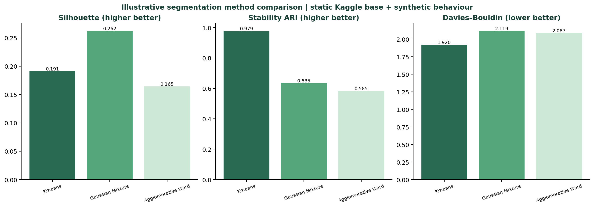

# Hội đồng quản trị: Customer intelligence và retention V2

**Trạng thái:** `DRAFT — evidence-backed segmentation prototype`  
**Cohort:** 10.000 khách hàng trong Kaggle base V1  
**Data version:** `v1-90f6625c31bd-baeb8804`  
**Nguồn của mỗi claim:** `OBSERVED_STATIC_DATA`, `SYNTHETIC_BEHAVIOR`, hoặc `EXPERIMENT_DESIGN`.

> Không có dòng dữ liệu nào cho biết lý do rời bỏ, nhu cầu đã phát biểu, consent, campaign outcome, doanh thu, CLV hoặc chi phí. Churn là nhãn tĩnh lịch sử, không có ngày quan sát/label window. Vì vậy báo cáo không gọi đây là dự báo quý tới, nguyên nhân churn, hay ROI thực tế.

## 1. Quyết định cần hội đồng phê duyệt

1. **Không triển khai ưu đãi đại trà.** Thử nghiệm retention phải bắt đầu bằng cohort đã có consent, capacity và suppression policy.
2. **Ưu tiên pilot cho segment_02.** Nhóm này có churn tĩnh 25,1% (579/2.303; Wilson 95%: 23,4–27,0%), cao hơn cohort 20,4% là 4,8 điểm phần trăm. Đây là cross-tab, không phải xác suất churn tương lai.
3. **Dùng segment_01 làm coverage cohort.** Nhóm này chứa 7.697 khách và 1.458 nhãn churn lịch sử, nhưng churn rate thấp hơn cohort: 18,9% (18,1–19,8%).

## 2. Schema, grain và vai trò từng field

ERD đầy đủ: [data architecture V2](data_architecture_v2.md). Dictionary chi tiết: [data dictionary V2](data_dictionary_v2.md).

| Bảng / field family | Grain | Chức năng | Source tag | Không được suy ra |
| --- | --- | --- | --- | --- |
| `customer_base`: country, gender, age, tenure, balance, products, active flag, estimated salary | 1 khách | Bối cảnh hồ sơ, lens và fairness audit | `OBSERVED_STATIC_DATA` | quê quán, quốc tịch, ethnicity, income thực, giá trị khách hàng |
| `synthetic_behavior`: monthly transactions, spend, logins, complaints, mobile/ATM/branch | 1 khách x 6 tháng mô phỏng | Tạo RFM và cluster | `SYNTHETIC_BEHAVIOR` | hành vi ngân hàng quan sát được |
| RFM/trend: recency, frequency, spend, ticket, digital share, activity ratio, transaction/login trend, complaint rate | 1 khách tại cutoff mô phỏng | Input behavior-only cho clustering | `SYNTHETIC_BEHAVIOR` | nguyên nhân hay dự báo churn thật |
| `synthetic_persona_scenarios`: pain signal, need-to-test, journey | 1 khách | Chỉ định treatment cho A/B test | `SYNTHETIC_BEHAVIOR` | pain point/năng lực chi trả/mong muốn thực tế |
| `labels_clean.churn` | 1 khách | Cross-tab sau khi cluster | `OBSERVED_STATIC_DATA` | horizon quý tới hoặc causal uplift |

**Kiểm soát:** generator không nhận `churn`; label được join sau clustering. Gender/country không được fit vào cluster, không chọn offer hay eligibility.

## 3. Kiểm chứng phân cụm

| Thuật toán, k=2 | Silhouette | Stability ARI | Davies–Bouldin | Quyết định |
| --- | ---: | ---: | ---: | --- |
| Gaussian Mixture | 0,231 | 0,875 | 2,097 | **Champion**, composite 0,700 |
| K-Means | 0,185 | 0,957 | 2,011 | Ứng viên ổn định nhất nhưng composite 0,650 |
| Ward hierarchical | 0,211 | 0,811 | 2,067 | Composite 0,525 |

Các số này chứng minh cấu trúc hình học và độ lặp trong dữ liệu mô phỏng, không chứng minh persona tồn tại ngoài đời. Figure profile và churn cross-tab: [persona heatmap](../reports/segmentation/v2/figures/persona_profiles.png), [churn cross-tab](../reports/segmentation/v2/figures/segment_churn_cross_tab.png).

## 4. Persona cards

### Segment_02 — hoạt động thấp trong mô phỏng

**Quy mô và bằng chứng:** 2.303 khách (23,0% cohort); 579 nhãn churn tĩnh, 25,1% (Wilson 95%: 23,4–27,0%).  
**Chân dung quan sát được:** female 46,5%, male 53,5%; France 50,2%, Germany 24,8%, Spain 25,0%. `country` là quốc gia được ghi nhận, không phải quê quán. Tuổi trung bình 40,0; median salary estimate 92.915,84; median balance 98.649,55, đơn vị source không rõ; trung bình 1,5 sản phẩm; 33,3% có active-member flag.  
**Hành vi mô phỏng:** 2,6 giao dịch/tháng, 75,9 spend/tháng, 3,8 logins/tháng, 57,3% digital share, 80,2% active months.  
**Pain/need trong simulation:** 30,3% có service-contact signal; 24,5% có low-activity signal. Đây là logic tạo journey, không phải lời nói khách hàng hoặc lý do churn.  
**Hành động:** treatment A là journey tái kích hoạt in-app/email, không blanket discount. Với service-contact signal, treatment chuyển thành service recovery trước khuyến mãi. Owner: CRM Lifecycle + Customer Care.  
**A/B test:** randomize trong nhóm đủ consent; control nhận trải nghiệm trung lập. Primary KPI: incremental 90-day active-month rate và retention. Guardrail: opt-out, frequency, complaint rate. Stop khi guardrail xấu đi theo ngưỡng đăng ký trước.

### Segment_01 — engagement/spend cao hơn trong mô phỏng

**Quy mô và bằng chứng:** 7.697 khách (77,0%); 1.458 nhãn churn tĩnh, 18,9% (Wilson 95%: 18,1–19,8%).  
**Chân dung quan sát được:** female 45,1%, male 54,9%; France 50,1%, Germany 25,2%, Spain 24,7%; tuổi trung bình 38,6; median salary estimate 102.299,81; median balance 96.674,55; 57,0% active-member flag.  
**Hành vi mô phỏng:** 3,9 giao dịch/tháng, 115,8 spend/tháng, 4,9 logins/tháng, 62,2% digital share, 100,0% active months.  
**Pain/need trong simulation:** 27,8% service-contact signal; 19,7% digital self-service signal.  
**Hành động:** test product/value review hoặc self-service education tùy scenario mô phỏng; không suy ra nhu cầu thật. Owner: Retention + Product.  
**A/B test:** treatment là review/education đã consent, control trung lập. Primary KPI: product-fit completion và incremental retention. Guardrail: contact fatigue, cost per retained customer, complaint rate.

## 5. Ba lăng kính dữ liệu tĩnh, không phải cluster

| Lens | Nhóm | n | Churn tĩnh, 95% CI | Hàm ý vận hành |
| --- | --- | ---: | --- | --- |
| Relationship | Not-active member | 4.849 | 26,9% [25,6–28,1] | Pre-specify as analysis stratum, không tự động contact |
| Relationship | Active member | 5.151 | 14,3% [13,3–15,3] | So sánh treatment effect với nhóm trên |
| Product depth | 1 product | 5.084 | 27,7% [26,5–29,0] | Product education hypothesis cần A/B test |
| Product depth | 2 products | 4.590 | 7,6% [6,9–8,4] | Baseline reference, không suy ra causal |
| Product depth | 3 products | 266 | 82,7% [77,7–86,8] | Nhóm nhỏ, cần service review; không scale offer từ cross-tab |
| Balance | Zero recorded balance | 3.617 | 13,8% [12,7–15,0] | Không gọi balance là value/revenue |
| Balance | Positive middle third | 2.127 | 27,6% [25,7–29,5] | Chỉ phục vụ capacity analysis và fairness review |

## 6. KPI, economics và roadmap

| Giai đoạn | Owner | KPI / gate | Quyết định |
| --- | --- | --- | --- |
| 0–30 ngày | Data + CRM | coverage, consent, suppression, data QA | no-go nếu không có consent/capacity |
| 31–60 ngày | CRM + Product | treatment/control balance, contact rate, opt-out, complaint | dừng khi guardrail vượt ngưỡng đăng ký trước |
| 61–90 ngày | Analytics + Finance | incremental retention CI; cost/contact; cost/saved customer | scale chỉ khi CI dương và Finance xác nhận break-even |
| 6–12 tháng | Data Product | observed transactions, service reasons, real label window | thay simulation bằng observed behavioral evidence |

Finance phải tự cung cấp contribution per saved customer, contact cost, incentive cost và operating cost. Khi đó dùng: `break_even_uplift = total_incremental_cost / (eligible_customers × incremental_contribution_per_saved_customer)`. Không được thay uplift bằng churn rate, AUC hoặc probability.

## 7. Evidentiary register

| ID | Finding | Evidence file | Strength | What falsifies it |
| --- | --- | --- | --- | --- |
| I-01 | Segment_02 churn cross-tab cao hơn cohort | `segment_churn_cross_tab.csv` | L1 observed static association | real time-indexed outcome / changed cohort definition |
| I-02 | GMM k=2 wins stated composite | `method_summary.csv` | internal synthetic diagnostic | multi-seed/assumption sensitivity fails |
| I-03 | Not-active member cross-tab is higher than active member | `static_lens_churn_cross_tab.csv` | L1 observed static association | adjusted/temporal analysis changes result |
| I-04 | Service recovery/reactivation are candidate treatments | `segment_synthetic_scenarios.csv` | L2 simulation design | randomized pilot shows no uplift or harms guardrail |

## 8. Release gate

This is a strong segmentation artifact, but it is **not an internal >95/100 release**. Missing evidence includes five-seed generator sensitivity, ten-run cluster stability, classifier/risk overlay, value scenario with Finance inputs, served OOD assignment, full dashboard/deployment and an item-level scorecard. The document is decision-ready for a scoped simulated pilot design, not for production contact.
